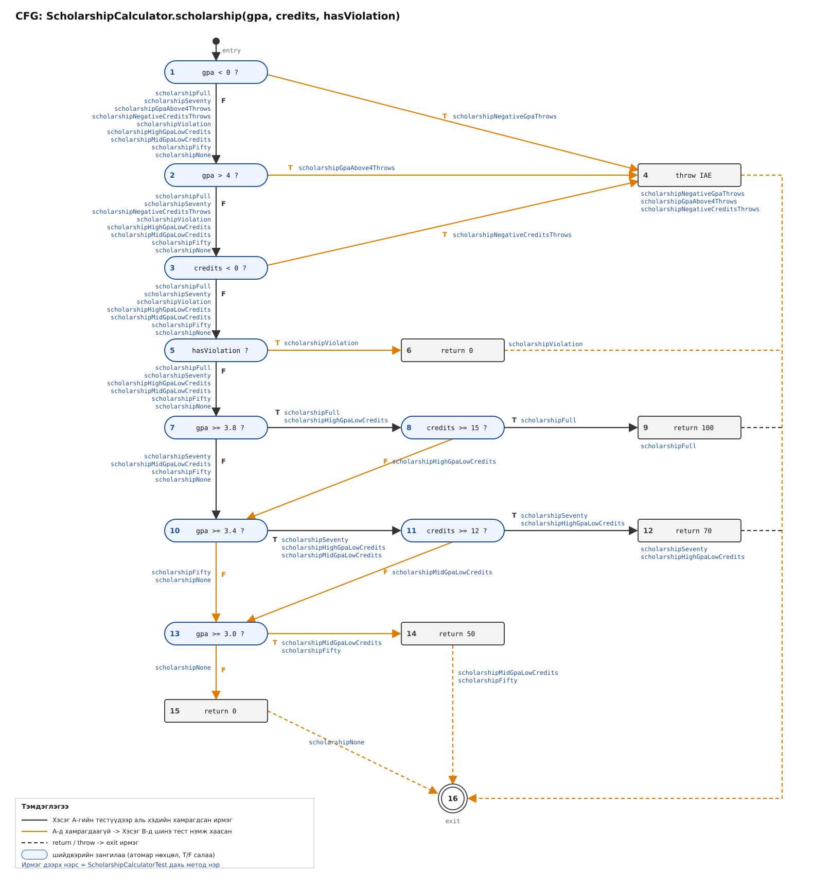

# Lab09 — Jacoco Coverage

- **Оюутны нэр:** Z.Ankhbayar
- **Оюутны код:** B232270029

## Хэсэг A: Happy path тестүүд ба эхний хэмжилт

Тест: `src/test/java/mn/edu/must/sqat/ScholarshipCalculatorTest.java` — зөвхөн хэвийн урсгалын 5 тест:

| # | Тест | Хүлээгдэх үр дүн |
|---|------|------------------|
| 1 | `letterGrade(95)` | `"A"` |
| 2 | `letterGrade(85)` | `"B"` |
| 3 | `gpa([95, 85])` | `3.5` |
| 4 | `scholarship(3.9, 16, false)` | `100` |
| 5 | `scholarship(3.5, 13, false)` | `70` |

Гаралт: `results/mvn-verify-A.txt` (Tests run: 5, Failures: 0, BUILD SUCCESS), `results/jacoco-A.csv`.

### Хамралт (`results/jacoco-A.csv`-ээс)

| Хэмжүүр | Covered | Missed | Хамралт |
|---------|---------|--------|---------|
| Line | 15 | 10 | 15/25 = **60%** |
| Branch | 20 | 21 | 20/41 ≈ **49%** |
| Instruction | 102 | 50 | 102/152 ≈ 67% |
| Method | 4 | 0 | 4/4 = 100% |

### Ажиглалт

**Шар ромбо (хагас хамрагдсан салаа):** `letterGrade`-ийн `score < 0 || score > 100` (м.20) болон `score >= 80` (м.24),
`gpa`-ийн `scores == null || scores.length == 0` (м.31) ба `switch` (м.36, 5-аас 3 салаа дутуу — зөвхөн A, B тохиолдол),
`scholarship`-ийн оролт шалгах нөхцөл (м.48), `hasViolation` (м.51), `gpa >= 3.8 && credits >= 15` (м.52),
`gpa >= 3.4 && credits >= 12` (м.53) — эдгээр нөхцөлүүд happy path-д зөвхөн нэг утга (ихэвчлэн `false` / "хэвийн") авсан тул
нөгөө салаа нь шалгагдаагүй.

**Улаан (огт хүрээгүй) мөрүүд** нь бүгд алдааны болон доод хязгаарын замууд: гурван `throw new IllegalArgumentException`
(м.21 буруу оноо, м.32 null/хоосон массив, м.49 буруу голч/кредит), `C`/`D`/`F` дүнгийн мөрүүд (м.25–27, м.39–40),
`scholarship`-ийн 50% ба 0% буцаах мөрүүд (м.54–55). Методын хамралт 100% байгаа ч энэ нь бүх логик шалгагдсан гэсэн үг биш —
сөрөг тест, хязгаарын утгын тест (60, 70, 80, 90, 3.0, 3.4, 3.8 г.м.) дутуу байна.


## Хэсэг B: CFG зурж branch 100% хүрэх

### `scholarship()`-ийн CFG



Нийлмэл нөхцөлүүдийг (`||`, `&&`) атомар нөхцөл бүрээр нь тусдаа шийдвэрийн зангилаа болгон задалсан (JaCoCo ч мөн
нөхцөл бүрийг тусдаа салаа гэж тоолдог): 1 `gpa < 0`, 2 `gpa > 4`, 3 `credits < 0`, 5 `hasViolation`, 7 `gpa >= 3.8`,
8 `credits >= 15`, 10 `gpa >= 3.4`, 11 `credits >= 12`, 13 `gpa >= 3.0` — 9 шийдвэр × 2 = 18 салаа. Ирмэг бүрийн хажууд
түүнийг дайрч буй тестийн метод нэрийг бичсэн. Улбар шар ирмэгүүд нь Хэсэг A-гийн дараа хамрагдаагүй байсан ирмэгүүд бөгөөд
эдгээр нь шинэ тестийн жагсаалт болсон.

### Нэмсэн тестүүд (16)

| Функц | Тест | Хаасан салаа / мөр |
|-------|------|--------------------|
| letterGrade | `letterGradeNegativeThrows` (−1) | `score < 0` = T → throw (assertThrows) |
| letterGrade | `letterGradeAbove100Throws` (101) | `score > 100` = T → throw (assertThrows) |
| letterGrade | `letterGradeC` (75) | `score >= 80` = F, `score >= 70` = T |
| letterGrade | `letterGradeD` (65) | `score >= 70` = F, `score > 60` = T |
| letterGrade | `letterGradeF` (50) | `score > 60` = F → `"F"` |
| gpa | `gpaNullThrows` | `scores == null` = T (assertThrows) |
| gpa | `gpaEmptyThrows` | `scores.length == 0` = T (assertThrows) |
| gpa | `gpaOfCDandF` ([75,65,50] → 1.0) | switch-ийн `C`, `D`, `default` (F) салаа |
| scholarship | `scholarshipNegativeGpaThrows` | `gpa < 0` = T (assertThrows) |
| scholarship | `scholarshipGpaAbove4Throws` | `gpa > 4` = T (assertThrows) |
| scholarship | `scholarshipNegativeCreditsThrows` | `credits < 0` = T (assertThrows) |
| scholarship | `scholarshipViolation` | `hasViolation` = T → 0 |
| scholarship | `scholarshipHighGpaLowCredits` (3.9, 12) | `gpa >= 3.8` = T, `credits >= 15` = **F** → 70 |
| scholarship | `scholarshipMidGpaLowCredits` (3.5, 10) | `gpa >= 3.4` = T, `credits >= 12` = **F** → 50 |
| scholarship | `scholarshipFifty` (3.2, 20) | `gpa >= 3.4` = F, `gpa >= 3.0` = T → 50 |
| scholarship | `scholarshipNone` (2.5, 20) | `gpa >= 3.0` = F → 0 |

### Үр дүн (`results/jacoco-B.csv`)

| Хэмжүүр | Covered | Missed | Хамралт |
|---------|---------|--------|---------|
| Line | 25 | **0** | 25/25 = **100%** |
| Branch | 41 | **0** | 41/41 = **100%** |
| Instruction | 152 | 0 | 100% |

**Нийт 21 тест** шаардагдсан (Хэсэг A-гийн 5 + Хэсэг B-ийн 16), энэ нь `results/mvn-verify-B.txt`-ийн
`Tests run: 21, Failures: 0` мөртэй таарна.

Тэмдэглэл: `||` нөхцөлийн гурван дэд нөхцөл тус бүрд тусдаа `assertThrows` тест хэрэгтэй байсан — нэг л тестээр шалгавал
богино холболтын (short-circuit) улмаас үлдсэн нөхцөлүүдийн T салаа хамрагдахгүй. Мөн 100% branch хамралт нь алдаагүй гэсэн
үг биш: `letterGrade`-ийн `score > 60` (спецификаци `>= 60`) алдааг 65/50 гэсэн утгууд илрүүлэхгүй, зөвхөн хязгаарын утга
60 л илрүүлнэ.


## Хэсэг C: Давталтын заагийн тестүүд (`gpa()`)

| Давталт | Тест | Оролт → хүлээгдэх |
|---------|------|-------------------|
| 0 удаа | `gpaEmptyThrows` | `[]` → `IllegalArgumentException` (assertThrows) |
| 0 удаа | `gpaNullThrows` | `null` → `IllegalArgumentException` (assertThrows) |
| 1 удаа | `gpaLoopOnce` | `[95]` → `4.0` |
| 2+ удаа | `gpaLoopMany` | `[95, 85, 75, 65]` → `2.5` |

0 удаагийн тестүүдийг Хэсэг B-д бичсэн байсан; 1 ба 2+ удаагийн тестүүдийг нэмсэн. Хамралт аль хэдийн 100% байсан тул эдгээр тест тоог өсгөөгүй.

**Яагаад хэрэгтэй хэвээр вэ:** Branch хамралт давталтын нөхцөл нэг удаа үнэн, нэг удаа худал болсон эсэхийг л харна. Энэ нь давталтын
биеийг 0, 1, олон удаа ажиллуулахад гарч болох алдааг (ж: хуримтлуулагчийг буруу эхлүүлэх, зөвхөн эхний/сүүлийн элементийг тоолох,
`scores.length`-ийн оронд тогтмол тоонд хуваах) ялгахгүй. 1 элементтэй массив дээр голч нь тухайн дүнтэй тэнцүү байх ёстой, олон
элементтэй массив дээр бүх элементийг нэмж байгаа эсэх шалгагдана. Иймээс эдгээр тест хамралт өөрчлөгдөхгүй ч гэсэн шинэ алдааг барьж чадна.

## Хэсэг D: Хамралт 100% — гэхдээ алдаа амьд

Зааг утгын 7 тест нэмсэн: `letterGradeBoundary60IsD`, `letterGradeBoundary5999IsF`, `letterGradeBoundary6999IsD`,
`letterGradeBoundary0IsF`, `letterGradeBoundary100IsA`, `letterGradeBoundary8999IsB`, `letterGradeBoundary90IsA`.

**Унасан тест** (`results/mvn-test-D-fail.txt`):

```
[ERROR]   ScholarshipCalculatorTest.letterGradeBoundary60IsD:171 expected: <D> but was: <F>
[ERROR] Tests run: 30, Failures: 1, Errors: 0, Skipped: 0
```

**Алдаа:** `letterGrade`-д `if (score > 60) return "D";` гэж бичсэн байсан, харин спецификаци "60-69.99 → D" гэж заадаг. Тиймээс яг 60
оноо `"F"` болж байсан (off-by-one). Засвар: `>` → `>=` (тусдаа commit: *Fix letterGrade: > 60 -> >= 60, spec says 60 is D*).

**Засварын дараа** (`results/mvn-verify-final.txt`, `results/jacoco-final.csv`): `Tests run: 30, Failures: 0`, BUILD SUCCESS;
Line 25/25 = 100%, Branch 41/41 = 100%.

### Лабын гол дүгнэлт

Хэсэг B-ийн төгсгөлд Branch болон Line хамралт хоёул 100% байсан ч код буруу байсан. `score > 60` ба `score >= 60` хоёул яг ижил хоёр
салааг (T/F) үүсгэдэг тул 65 (T) ба 50 (F) гэх мэт заагаас хол утгууд хоёр салааг бүрэн хамарч, JaCoCo-д алдаа "үл үзэгдэгч" болж
байсан. Хоёр хувилбарын ялгаа зөвхөн зааг утга 60 дээр гардаг тул яг 60-ыг шалгасан тест л алдааг илрүүлсэн. Хамралт нь аль мөр,
аль салаа ажилласныг хэмждэг. Харин тэр мөр зөв үр дүн гаргасан эсэх, нөхцөл дэх оператор ба зааг утга спецификацитай таарч буй эсэх,
тест ямар хүчтэй assert хийж байгааг хэмждэггүй. Иймээс хамралт бага байвал энэ нь хангалтгүй тестийн дохио болно. Харин 100% хамралт
код зөв гэдгийг батлахгүй, түүнийг зааг утгын шинжилгээ, спецификацид суурилсан тестээр нөхөх шаардлагатай.
